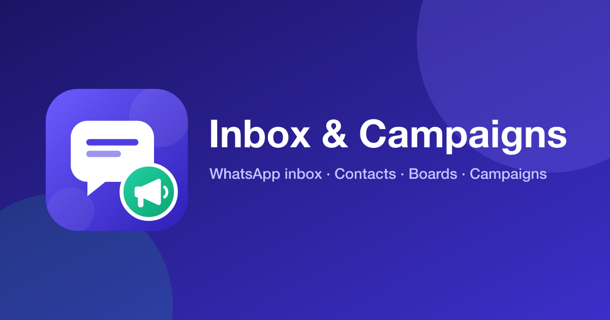
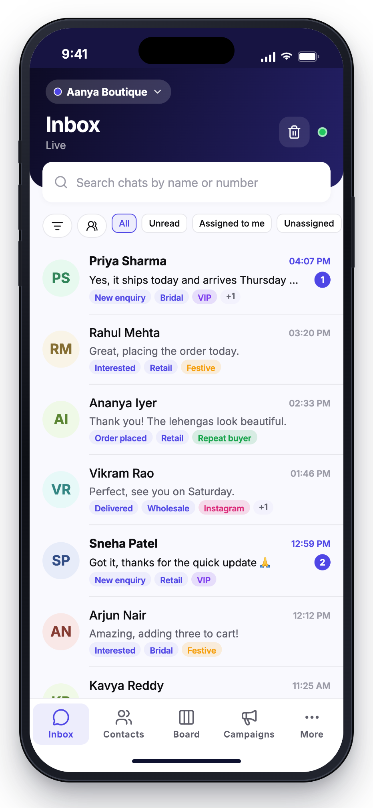
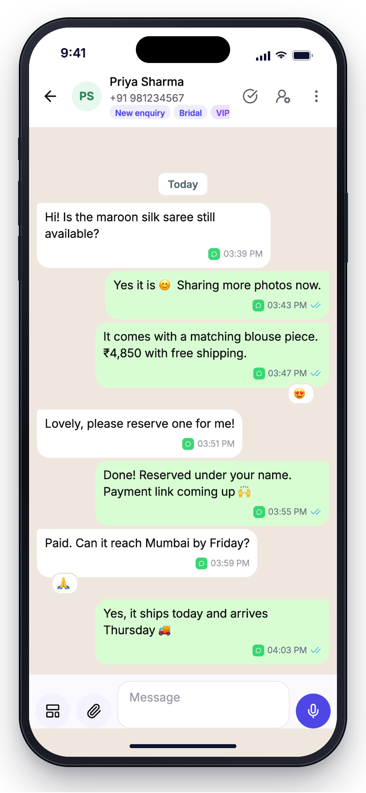
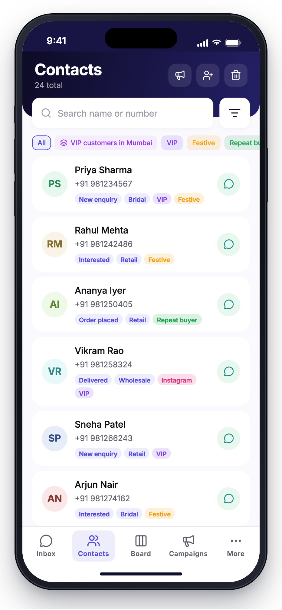
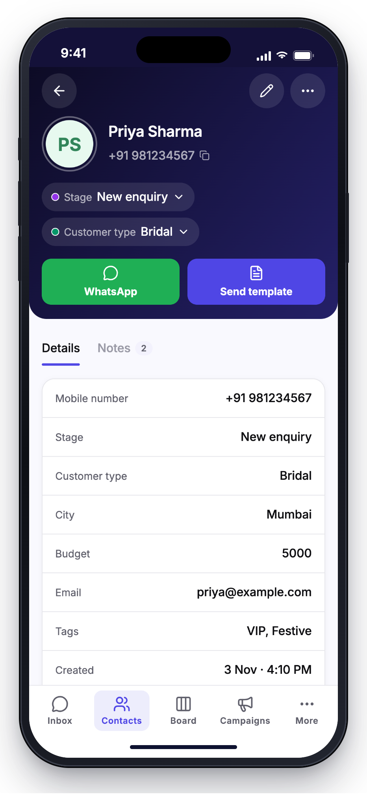
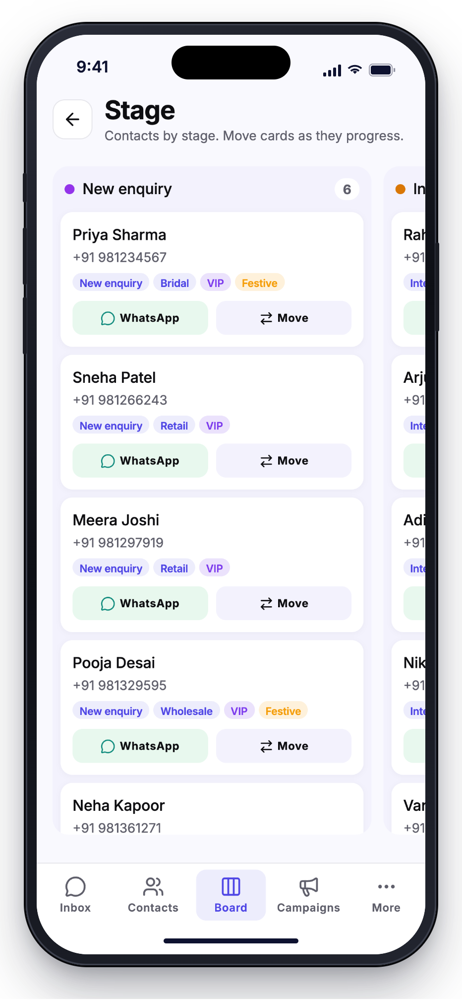
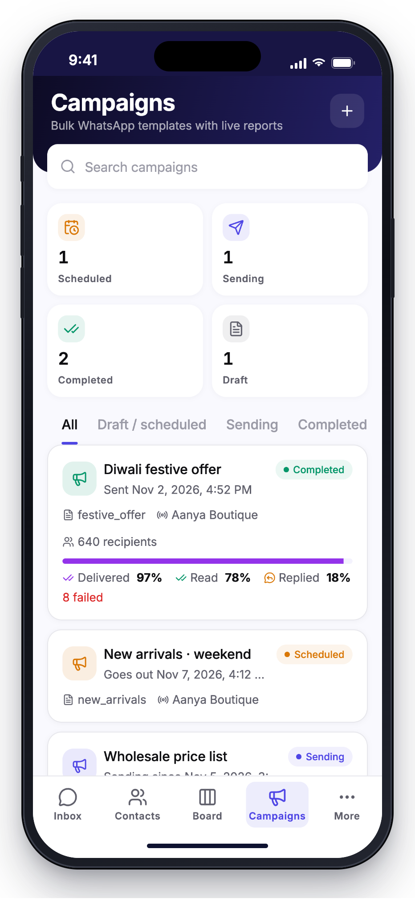
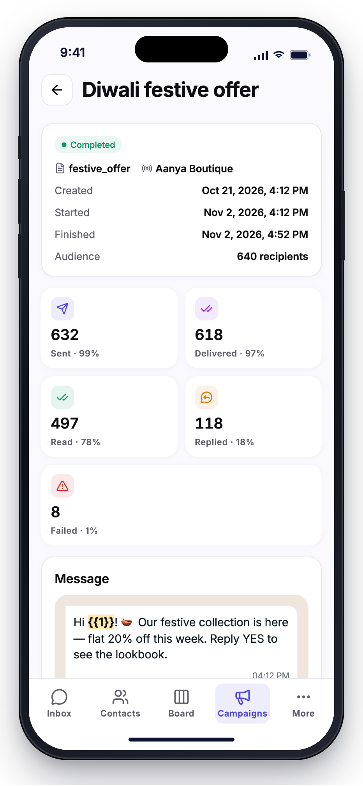
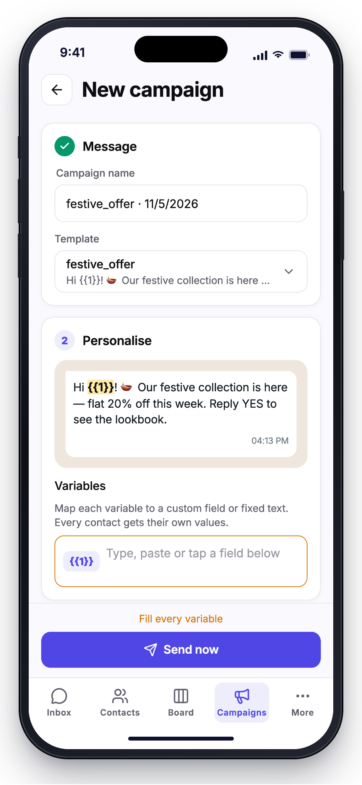

# Omnichannel Inbox & CRM App: Open Source WhatsApp Business Inbox, Contacts and Campaigns (React Native + Expo)

**Open-source omnichannel inbox, CRM and WhatsApp campaign app by [Com Bot AI Limited](https://com.bot).** One codebase for **Android, iPhone and the web**, powered by the **Com Bot AI Limited panel**: hosted authentication, CPaaS messaging gateway, live team inbox, contacts, templates and campaigns.

[](https://com.bot)
[](LICENSE)
[](https://docs.expo.dev)
[](https://reactnative.dev)



> **Want to launch this app under your own brand?** Join the **[Com Bot AI Limited partner program](https://com.bot)**. You get the backend panel this app runs on (WhatsApp Business API, Instagram and RCS channels, inbox, CRM and campaigns), and this source code to publish as your own app on Google Play, the App Store and the web.

---

## Contents

- [Screenshots](#screenshots)
- [Why this project](#why-this-project)
- [Features](#features)
- [How it works: the Com Bot AI Limited backend](#how-it-works-the-com-bot-ai-limited-backend)
- [Partner program: run this app as your own business](#partner-program-run-this-app-as-your-own-business)
- [Tech stack](#tech-stack)
- [Getting started](#getting-started)
- [Build and publish (Android, iOS, web)](#build-and-publish-android-ios-web)
- [Project layout](#project-layout)
- [FAQ](#faq)
- [License](#license)

---

## Screenshots

<table>
  <tr>
    <td align="center" width="25%"><br><sub><b>Inbox</b></sub></td>
    <td align="center" width="25%"><br><sub><b>Chat</b></sub></td>
    <td align="center" width="25%"><br><sub><b>Contacts</b></sub></td>
    <td align="center" width="25%"><br><sub><b>Contact profile</b></sub></td>
  </tr>
  <tr>
    <td align="center" width="25%"><br><sub><b>Kanban board</b></sub></td>
    <td align="center" width="25%"><br><sub><b>Campaigns</b></sub></td>
    <td align="center" width="25%"><br><sub><b>Campaign report</b></sub></td>
    <td align="center" width="25%"><br><sub><b>New campaign</b></sub></td>
  </tr>
</table>

<sub>Sample business and contacts are fictional.</sub>

## Why this project

Customers write on WhatsApp, Instagram and RCS, often the same person on more than one channel. Teams need **one shared inbox** on their phones to answer them, a **CRM** that knows who each person is, and **campaigns** that reach the right segment with approved WhatsApp templates.

This repository is the full, production mobile and web app for that: a **WhatsApp Business inbox app**, **omnichannel customer chat app**, **mobile CRM** and **bulk WhatsApp campaign sender**. It is open source, so agencies, resellers and developers can study it, extend it and ship it under their own brand through the Com Bot AI Limited partner program.

## Features

### Omnichannel team inbox
- Live, shared inbox for **WhatsApp Business API**, **Instagram DMs** and **RCS**, with a channel badge on every message so you always know where it came from.
- Text, photos, videos, documents and **voice notes**; WhatsApp-style **photo albums**, date separators, replies and a full-screen media viewer.
- **Message reactions**, sent and received: a contact's emoji shows under the message it reacts to, and you react from a quick bar or a full emoji sheet.
- **Stickers**, sent and received: reuse any sticker from your chats in one tap, or turn a photo into a WhatsApp sticker (512×512 WebP, under 100 KB) right on the phone.
- **WhatsApp message templates** outside the 24-hour window, with fast inline variable editing; create new templates right from a chat.
- **Quick replies** with `/` shortcuts, chat transfer between team members, tags, bots and automations, archive, close and block.
- Long-press **multi-select**: react, reply, forward, copy, delete, or save media to the phone gallery.
- **Push notifications** (Firebase Cloud Messaging) that open the right chat in the right account.

### CRM and contacts
- Contacts with the workspace's own **custom fields**, **tags**, **saved segments**, notes and trash.
- Quick filter chips for segments and tags; inline dropdown fields to change a lead's status in one tap.
- **Kanban boards** built from any dropdown field: each option is a column, and cards move between columns.
- **Import** from Excel or CSV, mapping columns to your fields.
- **Phone contacts sync** per account (automatic or manual), with a block list of contacts that are never sent to the CRM.

### WhatsApp campaigns
- Bulk **WhatsApp template campaigns** to a segment, a filter, picked contacts, pasted numbers or a CSV.
- Send now or **schedule**; track sending, completed, failed and cancelled campaigns.
- Personalise template variables with contact fields such as `[[name]]`.

### Channels, accounts and security
- Connect **WhatsApp Business** numbers (embedded signup), edit the business profile, see wallet balance and activity, and sync, create or delete templates.
- **Multiple accounts and workspaces** on one device, with instant switching.
- Per-account **PIN lock** on the device, reset with the account password; optional "remember password".
- **Share to the app** from any other app (text, photos, files) and send it to a chat.
- Role-based permissions: the app hides what a team member's role can't do, and the server enforces it.

### Everywhere
- **Android, iPhone and web (PWA)** from one TypeScript codebase.
- **17 languages**, including right-to-left layouts for Arabic and Urdu.
- Light and dark themes.

## How it works: the Com Bot AI Limited backend

The app is a client. All data, messaging and business logic live in the **Com Bot AI Limited panel**, the hosted backend that partners get through the [partner program](https://com.bot). The app creates nothing on its own: sign in, and the inbox and CRM work against your workspace as it is.

| Part of the panel | What it does for the app | Package / setting |
| --- | --- | --- |
| **Auth as a Service (SSO)** | Sign-up, login, OTP and email verification, 2FA, captcha, password reset, account and workspace picker, team members and roles | `@ab-ecosystem/sso`, `EXPO_PUBLIC_SSO_URL` |
| **CPaaS CRM gateway** | Contacts, custom fields, tags, segments, notes, quick replies, channels, WhatsApp templates, campaigns, media uploads, push registration | `@ab-ecosystem/cpaas`, `EXPO_PUBLIC_CPASS_BASE_URL` |
| **Live inbox socket** | Real-time messages, delivery and read receipts, chat assignment, typing state | `@ab-ecosystem/cpaas` Inbox, `EXPO_PUBLIC_INBOX_URL` |
| **Channel connections** | WhatsApp Business API (Meta embedded signup), Instagram and RCS, wallet and usage | Configured in the panel |

Each workspace has an **Access ID** (project id). Users enter it at sign-in or scan it as a QR code (`inboxcampaign://access/<id>`), so **one published app can serve many businesses**, each with its own data.

Two ways to ship it:

- **Multi-workspace app** (leave `EXPO_PUBLIC_ACCESS_ID` empty): one app on the stores for all your clients. Each account enters or scans its own Access ID.
- **Single-workspace app** (set `EXPO_PUBLIC_ACCESS_ID`): a branded app for one business. Users go straight to the login screen and never see an Access ID.

See [docs/ARCHITECTURE.md](docs/ARCHITECTURE.md) for how every screen maps onto the backend.

## Partner program: run this app as your own business

**[Sign up for the Com Bot AI Limited partner program at com.bot](https://com.bot)** to:

- Get the **backend panel** this app needs: auth, CPaaS gateway, live inbox and channel onboarding, hosted and maintained for you.
- **White-label** this app: your name, icon, colours and store listing, built from this repository.
- Offer **WhatsApp Business API**, Instagram and RCS messaging, an omnichannel inbox, a CRM and WhatsApp campaigns to your own customers.
- Onboard your clients as separate workspaces, each with its own Access ID, team members and roles.
- Publish **one app for all your clients**, or a **dedicated branded app per client** locked to their workspace with a single setting (`EXPO_PUBLIC_ACCESS_ID`).
- Skip building and running servers: you ship the app, and the panel does the rest.

Whether you are a marketing agency, a SaaS reseller, a WhatsApp solution provider or a developer building for clients, the partner program gives you a ready backend and a ready app.

**→ [Become a partner at com.bot](https://com.bot)**

## Tech stack

- **Expo SDK 58**, **React Native 0.88**, **React 19** with the React Compiler, TypeScript
- **Expo Router** (file-based, typed routes) for Android, iOS and web
- **TanStack Query** for server state, **zustand** for app state, **react-native-mmkv** and **expo-secure-store** for storage
- **Firebase Cloud Messaging** for push notifications
- **i18next** with 17 locales
- **EAS Build** and **EAS Submit** for store builds; static web export for hosting
- Jest tests for filters, contact mapping, phone parsing, templates, inbox logic and locale parity

## Getting started

### Prerequisites
- Node.js 20+ and npm
- A **Com Bot AI Limited partner account**, for the backend URLs and an Access ID: [sign up at com.bot](https://com.bot)
- A Firebase project, for push notifications on Android and iOS

### Setup

```bash
git clone https://github.com/ComBotAI/WhatsApp-Cloud-Api-Omnichannel-Inbox-Crm.git
cd WhatsApp-Cloud-Api-Omnichannel-Inbox-Crm
npm install
cp .env.example .env    # then fill in the values below
```

| Variable | What it is |
| --- | --- |
| `EXPO_PUBLIC_SSO_URL` | Auth-as-a-Service origin from your panel (the `/api/v1/projects/:id/...` host) |
| `EXPO_PUBLIC_CPASS_BASE_URL` | CPaaS CRM gateway origin from your panel |
| `EXPO_PUBLIC_INBOX_URL` | Live inbox socket origin from your panel |
| `EXPO_PUBLIC_ACCESS_ID` | Optional: lock the app to **one Access ID**. Users go straight to login and never see the Access ID screen. Leave empty for a multi-workspace app where each account enters its own Access ID |
| `EXPO_PUBLIC_SDK_CLIENT_ID` | Optional default that pre-fills the Access ID screen (ignored when `EXPO_PUBLIC_ACCESS_ID` is set) |
| `EXPO_PUBLIC_APP_ORIGIN` | Sent as the `origin` header; must be allowed on your SSO project, CPaaS and captcha key |
| `EXPO_PUBLIC_FIREBASE_VAPID_KEY` | Optional: web push key |

All `EXPO_PUBLIC_*` values are bundled into the app, so they are not secrets. Never put private keys in `.env`.

**Firebase:** add your own `google-services.json` (Android) and `GoogleService-Info.plist` (iOS) to the project root, registered for your app's package / bundle ID. They are git-ignored.

### Run

The app uses native modules (Firebase messaging and others), so it needs a **development build**, not Expo Go.

```bash
npx expo run:android      # or: npx expo run:ios
npx eas-cli@latest build --profile development --platform android   # cloud dev build

npx expo start --web      # web
```

### Quality checks

```bash
npm run typecheck   # tsc --noEmit
npm run lint        # expo lint
npm test            # jest
```

## Build and publish (Android, iOS, web)

| Target | Command |
| --- | --- |
| Android test APK | `npx eas-cli@latest build -p android --profile preview` |
| Google Play (AAB) | `npx eas-cli@latest build -p android --profile production` |
| App Store | `npx eas-cli@latest build -p ios --profile production` |
| Submit to stores | `npx eas-cli@latest submit -p android` / `-p ios` |
| Web (static site in `dist/`) | `npx expo export --platform web` |

**To white-label it**, change the name, `slug`, `scheme`, Android `package`, iOS `bundleIdentifier`, `owner` and icons in [app.json](app.json), and the site URL and texts in [src/app/+html.tsx](src/app/+html.tsx) and [public/](public/). For an app made for one client, set `EXPO_PUBLIC_ACCESS_ID` to their Access ID so users go straight to login. Then run `npx eas-cli@latest init` to link the app to your own EAS project. Hosting examples are in [hosting/](hosting/) (nginx), [vercel.json](vercel.json) and [public/_redirects](public/_redirects).

Default identifiers in this repository:

| | |
| --- | --- |
| Android package / iOS bundle ID | `com.inbox.campaign` |
| Expo slug | `inbox-and-campaigns` |
| Link scheme | `inboxcampaign://` (WhatsApp signup returns to `inboxcampaign://channel-connected`) |

## Project layout

```
src/app              routes (expo-router): sign-in, Inbox · Contacts · Boards · More,
                     campaigns, channels, chat, contact, import, settings, share
src/components       UI kit, inbox, contacts, campaigns, channels, WhatsApp template pieces
src/services/crm     CPaaS: contacts, fields, notes, segments, channels, templates, campaigns, import
src/services/inbox   live inbox socket, sending, media upload and download, albums, reactions, stickers
src/services/sso     native auth client (SSO endpoints)
src/stores           zustand: auth, accounts, app lock, settings
src/i18n             i18next + 17 locales
docs                 architecture and design notes
```

## FAQ

**Is this a WhatsApp Business API app?**
Yes. It works with official WhatsApp Business API numbers connected through the Com Bot AI Limited panel, including approved message templates and campaigns. It is not a WhatsApp Web automation tool.

**Can I use it without the Com Bot AI Limited backend?**
The app is built for the Com Bot AI Limited panel APIs (SSO and CPaaS). The quickest way to get a working backend is the [partner program](https://com.bot).

**Can I publish it under my own brand?**
Yes. The code is MIT licensed. Change the app identity as described in [Build and publish](#build-and-publish-android-ios-web), and connect it to your panel as a [partner](https://com.bot). Set `EXPO_PUBLIC_ACCESS_ID` to make it a dedicated app for one business.

**Does it support WhatsApp reactions and stickers?**
Yes. Reactions show under the message they react to, and you can react to any message. Stickers can be sent and received, and any photo can be turned into a sticker in the app.

**Which channels are supported?**
WhatsApp Business API, Instagram direct messages and RCS in the inbox; WhatsApp templates for campaigns.

**Does it run on iPhone and the web?**
Yes: Android, iOS and a web app (PWA) from the same code.

**Which languages are included?**
17, with right-to-left support for Arabic and Urdu. Most non-English translations were machine-drafted; corrections are welcome.

## Contributing

Issues and pull requests are welcome. Please run `npm run typecheck`, `npm run lint` and `npm test` before opening a PR.

## License

[MIT](LICENSE) © Com Bot AI Limited

---

**Built by [Com Bot AI Limited](https://com.bot).** Omnichannel inbox, WhatsApp Business API, CRM and campaigns for businesses, agencies and partners. **[Join the partner program →](https://com.bot)**
